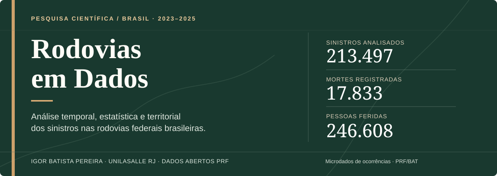
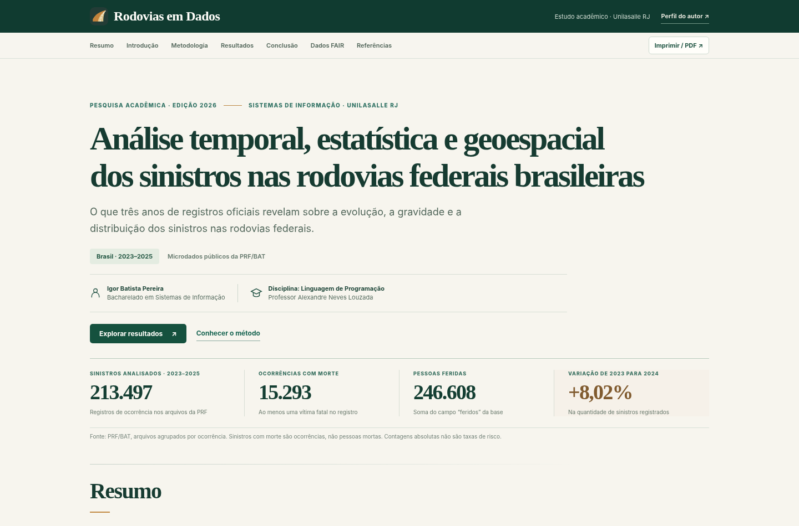
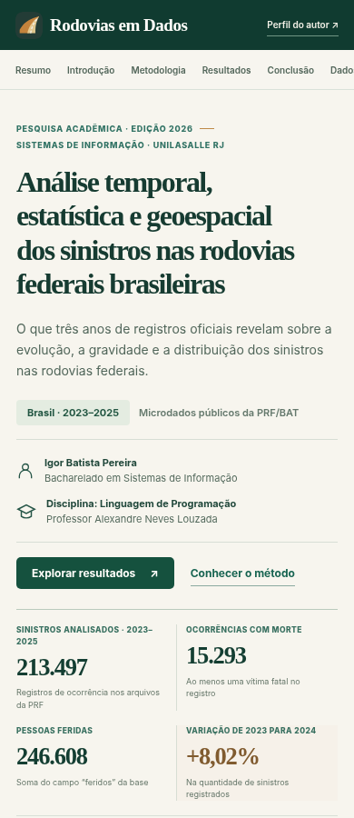

<div align="center">

<a href="https://igorbatistapdev.github.io/Rodovias-Em-Dados/" title="Abrir o artigo científico interativo">
  
</a>

<br>

<a href="https://igorbatistapdev.github.io/Rodovias-Em-Dados/" title="Explorar o artigo no GitHub Pages">
  
</a>

<br>

[**Ler artigo em PDF**](previews/Rodovias_em_Dados_2026_Artigo_Final_ABNT.pdf) &nbsp;·&nbsp; [**Explorar dados**](data/processed/) &nbsp;·&nbsp; [**Metodologia e execução**](#metodologia-e-reprodutibilidade)

<sub>Artigo científico digital · Sistemas de Informação · Unilasalle RJ · 2026</sub>

</div>

---

## Sobre a pesquisa

**Rodovias em Dados** é um artigo científico digital sobre a evolução temporal, os padrões de gravidade e a distribuição territorial dos sinistros registrados nas rodovias federais brasileiras de **2023 a 2025**.

A pesquisa parte dos microdados públicos da **Polícia Rodoviária Federal (PRF)**, processados por um pipeline reproduzível em Python. O resultado combina **análise exploratória, gráficos interativos e interpretação científica** em uma publicação web responsiva, acompanhada de uma versão em PDF A4.

O estudo foi desenvolvido por **Igor Batista Pereira**, no curso de **Sistemas de Informação da Unilasalle RJ**, na disciplina **Linguagem de Programação**, ministrada pelo professor **Alexandre Neves Louzada**.

### A pesquisa em números

| Indicador | 2023–2025 |
| :--- | ---: |
| **Sinistros analisados** | **213.497** |
| Pessoas feridas | 246.608 |
| Mortes registradas | 17.833 |
| Ocorrências com ao menos uma morte | 15.293 |

<sub>Fonte: microdados de acidentes agrupados por ocorrência da PRF/BAT. Mortes são pessoas falecidas; ocorrências com morte são registros com ao menos uma vítima fatal. Contagens absolutas não equivalem a taxas de risco ajustadas ao tráfego.</sub>

### Perguntas que orientam o estudo

| Eixo | Investigação |
| :--- | :--- |
| **01 · Evolução temporal** | Como os sinistros variaram entre anos e meses do período? |
| **02 · Padrões e gravidade** | Quais padrões surgem nos horários, dias, tipos e níveis de gravidade? |
| **03 · Distribuição territorial** | Como os registros se distribuem por unidade federativa e rodovia federal? |

## Explore a experiência

O artigo segue uma direção visual de **jornalismo de dados minimalista**: leitura vertical, tipografia editorial, visualizações com cores distintas, notas metodológicas e navegação adaptada ao celular.

<table>
  <tr>
    <td width="70%" align="center"></td>
    <td width="30%" align="center"></td>
  </tr>
  <tr><td align="center"><sub>Desktop</sub></td><td align="center"><sub>Mobile</sub></td></tr>
</table>

<div align="center">

**[Explorar os resultados no artigo interativo ↗](https://igorbatistapdev.github.io/Rodovias-Em-Dados/)**

</div>

## Metodologia e reprodutibilidade

O processamento preserva os arquivos originais, registra verificações de qualidade e produz as agregações e visualizações utilizadas pelo artigo.

```text
Dados abertos PRF/BAT (2023, 2024 e 2025)
                     ↓
            Leitura e validação
                     ↓
          Limpeza e padronização
                     ↓
          Análise exploratória
                     ↓
         Agregações e gráficos
                     ↓
          Artigo HTML + PDF A4
```

| Tecnologia | Finalidade |
| :--- | :--- |
| **Python, Pandas e NumPy** | Processamento, validação e agregação dos dados |
| **SQLite** | Persistência de resultados derivados |
| **HTML, CSS e JavaScript** | Publicação responsiva e interatividade |
| **Matplotlib e SVG** | Figuras vetoriais para impressão |
| **Pytest** | Testes automatizados |
| **GitHub Pages** | Hospedagem estática do artigo em `docs/` |

<details>
<summary><strong>Como executar no Windows com VS Code</strong></summary>

<br>

O pipeline foi validado no Python 3.13.5. A combinação de dependências não foi validada no Python 3.14.

```powershell
# Na raiz do repositório
py -3.13 -m venv .venv
.\.venv\Scripts\python.exe -m pip install --upgrade pip
.\.venv\Scripts\python.exe -m pip install -r requirements.txt
.\.venv\Scripts\python.exe scripts/run_pipeline.py
.\.venv\Scripts\python.exe -m pytest -q
.\.venv\Scripts\python.exe -m http.server 8000 -d docs
```

Acesse **http://localhost:8000**. Para somente visualizar o site gerado, basta executar `python -m http.server 8000 -d docs`; não é necessário instalar Pandas. O terminal do servidor permanece ocupado até pressionar `Ctrl+C`.

</details>

<details>
<summary><strong>Executar no Linux / macOS</strong></summary>

<br>

```bash
python3.13 -m venv .venv
source .venv/bin/activate
python -m pip install -r requirements.txt
python scripts/run_pipeline.py
python -m pytest -q
python -m http.server 8000 -d docs
```

</details>

<details>
<summary><strong>Estrutura do código e arquivos principais</strong></summary>

<br>

| Arquivo | Função |
| :--- | :--- |
| [`templates/article.html`](templates/article.html) | **Fonte editorial** do HTML gerado |
| [`docs/index.html`](docs/index.html) | Site publicado pelo GitHub Pages |
| [`docs/assets/css/style.css`](docs/assets/css/style.css) | Identidade visual e responsividade |
| [`docs/assets/css/print.css`](docs/assets/css/print.css) | Paginação e impressão A4 |
| [`docs/assets/js/`](docs/assets/js/) | Gráficos e interações |
| [`src/etl.py`](src/etl.py) | ETL, qualidade e agregações |
| [`src/visualizations.py`](src/visualizations.py) | Gráficos vetoriais da impressão |
| [`scripts/run_pipeline.py`](scripts/run_pipeline.py) | Orquestra o processamento |
| [`scripts/refinar_artigo.py`](scripts/refinar_artigo.py) | Renderiza o template em `docs/index.html` |
| [`data/raw/`](data/raw/) | Arquivos originais da PRF |
| [`data/processed/`](data/processed/) | Tabelas, auditoria e resultados |
| [`tests/`](tests/) | Testes automatizados |

> **Atenção:** alterações em `docs/index.html` podem ser sobrescritas pela execução do pipeline. Para editar o artigo, use `templates/article.html`.

</details>

## Ciência aberta, fontes e limites

O projeto documenta a proveniência, a integridade e as transformações dos dados, orientado pelos princípios **FAIR** (*Findable, Accessible, Interoperable, Reusable*).

- **Fontes oficiais:** [Dados abertos da PRF](https://www.gov.br/prf/pt-br/acesso-a-informacao/dados-abertos/dados-abertos-da-prf) · [Dicionário de dados da PRF](https://www.gov.br/prf/pt-br/acesso-a-informacao/dados-abertos/dicionario-acidentes).
- **Auditoria e rastreabilidade:** [`data/processed/auditoria.json`](data/processed/auditoria.json), com hashes SHA-256, validações e referências aos arquivos de origem.
- **Agregados e arquivos:** [`data/processed/`](data/processed/) e as exportações disponíveis no artigo.
- **Referências científicas:** [revisão bibliográfica e ABNT](REFERENCIAS_E_ABNT.md), orientada pelas NBR 6023:2025 e NBR 10520:2023.

**Limitações:** a análise é exploratória e descritiva, sem inferências causais. Comparações de contagens entre localidades não equivalem a comparações de risco ajustado à circulação de veículos.

## Qualidade e documentação

A edição v5.1 registra **23 testes automatizados aprovados**, além de verificações locais em larguras de 1440, 768, 390 e 360 pixels. As evidências e limitações dessas verificações estão detalhadas no relatório de qualidade; o deploy público exige conferência própria.

| Documento | Acesso |
| :--- | :--- |
| Relatório de qualidade | [`RELATORIO_QA.md`](RELATORIO_QA.md) |
| Revisão das referências | [`REFERENCIAS_E_ABNT.md`](REFERENCIAS_E_ABNT.md) |
| Guia de publicação | [`GUIA_PUBLICACAO_GITHUB_PAGES.md`](GUIA_PUBLICACAO_GITHUB_PAGES.md) |
| Artigo em PDF | [Abrir PDF](previews/Rodovias_em_Dados_2026_Artigo_Final_ABNT.pdf) |
| Metadados para citação | [`CITATION.cff`](CITATION.cff) |

A publicação pelo GitHub Pages disponibiliza os arquivos estáticos em `docs/`. O processamento Python é executado antes da publicação.

## Autoria e licenças

**Igor Batista Pereira** · Sistemas de Informação — Unilasalle RJ  
**Disciplina:** Linguagem de Programação · **Professor:** Alexandre Neves Louzada

O código autoral segue a [licença MIT](LICENSE). Texto e visualizações originais seguem os termos indicados em [LICENSE-CONTENT.md](LICENSE-CONTENT.md), incluindo CC BY 4.0. Os microdados da PRF preservam as condições da fonte original.

<div align="center">

---

<sub>Rodovias em Dados · Pesquisa acadêmica com dados públicos · 2026</sub>

</div>
